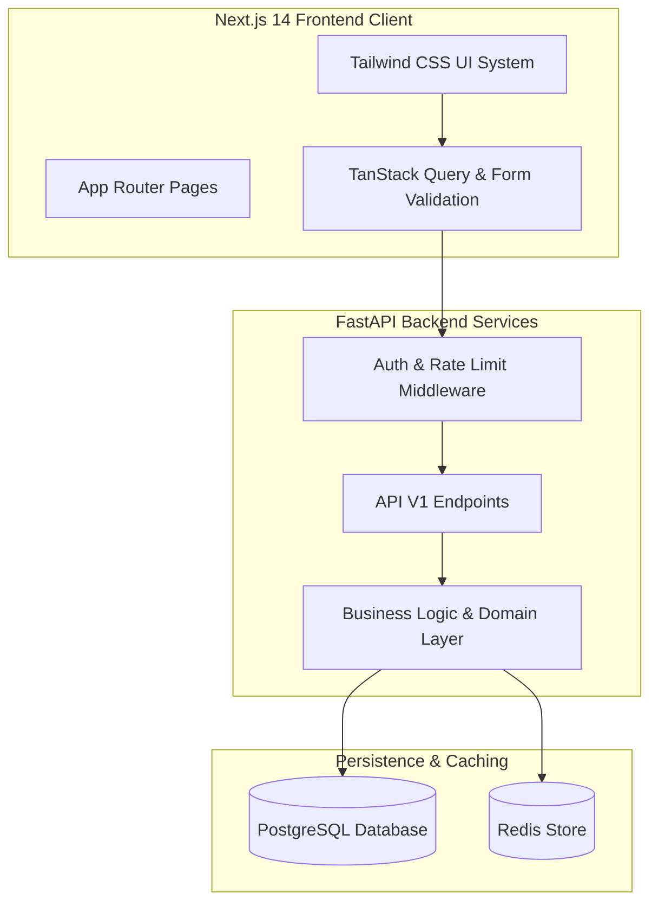

# School Management ERP — System Architecture

## Architecture Overview
The School Management ERP is designed following a modular, clean SaaS architecture separating backend domain services, data persistence layers, API routes, and client-side rendering.

## Layer Responsibilities
1. **Frontend**: Next.js 14 App Router, React 18, TypeScript, Tailwind CSS, TanStack Query v5, Lucide Icons, Recharts.
2. **Backend API**: Python 3.11+, FastAPI async framework, Pydantic v2 schemas, SQLAlchemy 2.0 ORM, structlog logging.
3. **Database**: PostgreSQL 16 relational engine enforcing unique constraints, foreign key cascades, and indexing.
4. **Cache & Tokens**: Redis 7 managing session tokens, rate limiting counters, and temporary blacklists.
