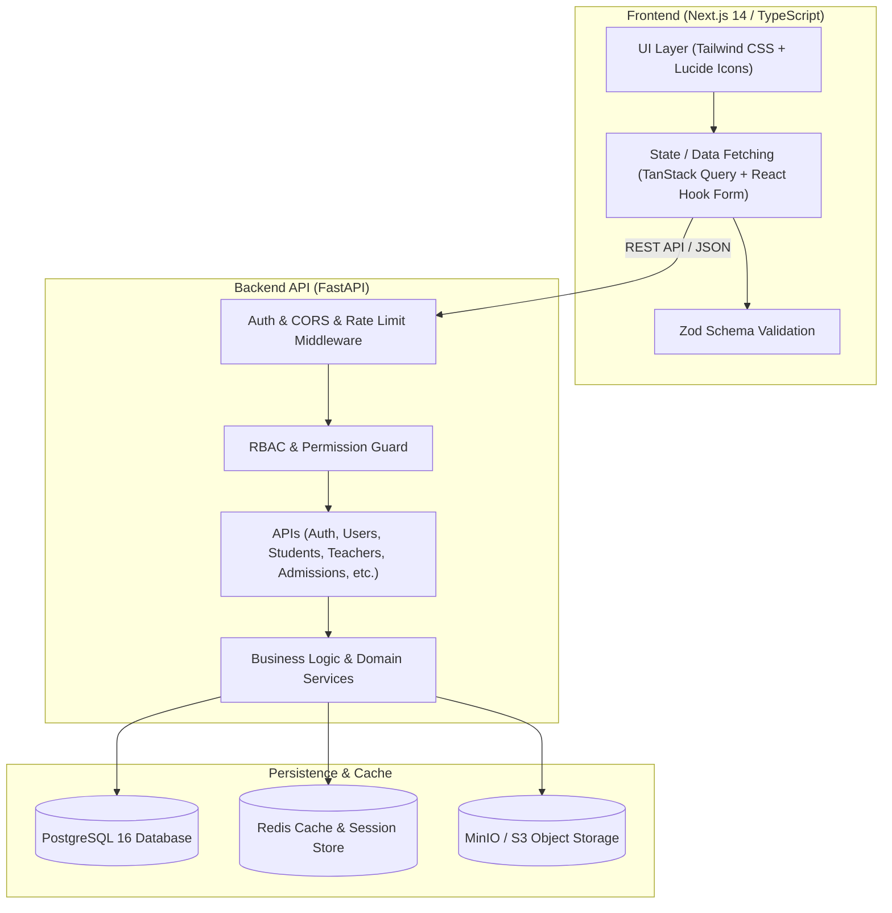
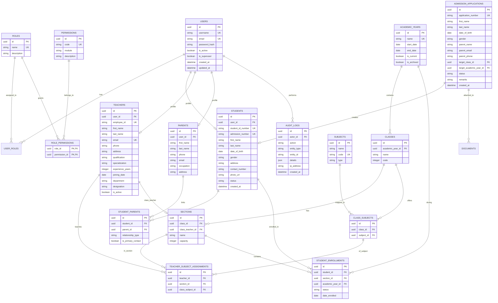

# School Management ERP — Architecture & Phase 1 Plan

## 1. Current Project Assessment
* **Directory State**: `c:\Users\My pc\Desktop\SMS` is currently an empty directory.
* **Execution Strategy**: Fresh greenfield setup for a robust, multi-tenant capable, production-ready monorepo.
* **Component Architecture**:
  * `backend/`: Python 3.11+ with FastAPI, Async SQLAlchemy 2.0, Pydantic v2, Alembic, Pytest, Redis client, structlog.
  * `frontend/`: Next.js 14+ (App Router), React 18, TypeScript, Tailwind CSS, TanStack Query v5, React Hook Form, Zod, Lucide Icons, Recharts.
  * `docker-compose.yml`: Local infrastructure orchestrating PostgreSQL 16, Redis 7, MinIO (S3 mock), FastAPI Backend, and Next.js Frontend.

---

## 2. Architecture Plan



### Architectural Principles & Security Design
1. **Security & Authentication**:
   * JWT Access Tokens (short-lived) + Secure HTTP-only Refresh Tokens stored in Redis.
   * Passwords hashed using bcrypt/argon2 with configurable complexity policy.
   * Token revocation & session invalidation stored in Redis cache.
   * Rate limiting per IP and user endpoint using Redis.
2. **Authorization (RBAC)**:
   * Fine-grained permission system based on `Role` -> `RolePermission` -> `Permission`.
   * Endpoint protection via FastAPI dependency injection guards (`require_permission("student:create")`).
   * Database-level filtering ensuring Students/Parents only access their linked records.
3. **Data Integrity & Auditability**:
   * All structural foreign keys enforced with cascade rules or RESTRICT where appropriate.
   * `AuditLog` table capturing actor_id, target_entity, action_type, old_values, new_values, timestamp, and IP address.
   * Multi-step operations wrapped in DB transactions (`async with session.begin()`).

---

## 3. Database ER Diagram



---

## 4. Database Schema Specifications

### Key Tables & Constraints:
1. `users`: UUID PK, unique username & email, indexed email, password_hash, status.
2. `roles`: Standard roles (`Super Admin`, `Principal`, `School Admin`, `Teacher`, `Student`, `Parent/Guardian`, `Accountant`, `Transport Manager`).
3. `permissions`: Granular string codes like `student:create`, `student:read`, `student:update`, `student:delete`, `admission:approve`.
4. `students`: Unique `student_id_number` and `admission_number`. Foreign key to `users(id)`.
5. `teachers`: Unique `employee_id` and `email`. Foreign key to `users(id)`.
6. `parents`: Linked to `users(id)` and associated with students via `student_parents` join table with compound unique constraint `(student_id, parent_id)`.
7. `academic_years`: Date validation check constraint (`end_date > start_date`), boolean `is_current` with partial unique index enforcing only 1 current active year.
8. `classes` & `sections`: Unique constraint on `(class_id, name)` for sections.
9. `admission_applications`: Status enum (`APPLIED`, `VERIFIED`, `UNDER_REVIEW`, `APPROVED`, `REJECTED`, `ENROLLED`). Unique application number format `APP-YYYY-XXXXX`.

---

## 5. Role-Permission Matrix (Phase 1)

| Permission Code | Super Admin | Principal | School Admin | Teacher | Student | Parent | Accountant | Transport Mgr |
|---|:---:|:---:|:---:|:---:|:---:|:---:|:---:|:---:|
| `users:manage` | ✅ | ✅ | ❌ | ❌ | ❌ | ❌ | ❌ | ❌ |
| `roles:manage` | ✅ | ❌ | ❌ | ❌ | ❌ | ❌ | ❌ | ❌ |
| `student:create` | ✅ | ✅ | ✅ | ❌ | ❌ | ❌ | ❌ | ❌ |
| `student:read` | ✅ | ✅ | ✅ | ✅ (assigned) | ✅ (own) | ✅ (child) | ✅ (basic) | ✅ (basic) |
| `student:update` | ✅ | ✅ | ✅ | ❌ | ❌ | ❌ | ❌ | ❌ |
| `teacher:manage` | ✅ | ✅ | ✅ | ❌ | ❌ | ❌ | ❌ | ❌ |
| `parent:manage` | ✅ | ✅ | ✅ | ❌ | ❌ | ❌ | ❌ | ❌ |
| `academics:manage`| ✅ | ✅ | ✅ | ❌ | ❌ | ❌ | ❌ | ❌ |
| `admission:manage`| ✅ | ✅ | ✅ | ❌ | ❌ | ❌ | ❌ | ❌ |
| `dashboard:view` | ✅ | ✅ | ✅ | ✅ | ✅ | ✅ | ✅ | ✅ |

---

## 6. API Structure (FastAPI)

```
/api/v1
  ├── /health                           GET
  ├── /auth
  │     ├── /login                      POST
  │     ├── /logout                     POST
  │     ├── /refresh                    POST
  │     ├── /forgot-password            POST
  │     ├── /reset-password             POST
  │     ├── /change-password            POST
  │     └── /me                         GET
  ├── /users
  │     ├── /                           GET, POST
  │     ├── /{user_id}                  GET, PUT, PATCH
  │     └── /{user_id}/status           PATCH
  ├── /roles
  │     ├── /                           GET
  │     └── /{role_id}/permissions      PUT
  ├── /students
  │     ├── /                           GET, POST
  │     ├── /{student_id}               GET, PUT, DELETE
  │     └── /{student_id}/profile       GET
  ├── /teachers
  │     ├── /                           GET, POST
  │     ├── /{teacher_id}               GET, PUT, PATCH
  │     └── /{teacher_id}/assignments   GET, POST
  ├── /parents
  │     ├── /                           GET, POST
  │     ├── /{parent_id}                GET, PUT
  │     └── /{parent_id}/link-student   POST, DELETE
  ├── /academic-years
  │     ├── /                           GET, POST
  │     ├── /{id}                       PUT
  │     └── /{id}/activate              PATCH
  ├── /classes
  │     ├── /                           GET, POST
  │     └── /{class_id}/sections        GET, POST
  ├── /sections
  │     └── /{section_id}               GET, PUT
  ├── /subjects
  │     ├── /                           GET, POST
  │     └── /assign-class               POST
  ├── /admissions
  │     ├── /                           GET, POST
  │     ├── /{id}                       GET, PUT
  │     ├── /{id}/status                PATCH
  │     └── /{id}/enroll                POST
  ├── /dashboard
  │     └── /stats                      GET
  └── /audit-logs
        └── /                           GET
```

---

## 7. Frontend Route Structure (Next.js App Router)

```
app/
  ├── (auth)/
  │     ├── login/page.tsx
  │     ├── forgot-password/page.tsx
  │     └── reset-password/page.tsx
  └── (dashboard)/
        ├── layout.tsx (Sidebar, Header, Dynamic Navigation by Role)
        ├── page.tsx (Dashboard Stats)
        ├── students/
        │     ├── page.tsx (List, Filter, Search, Pagination)
        │     ├── new/page.tsx (Form)
        │     └── [id]/page.tsx (Profile with Tabs: Overview, Academic, Attendance, Exams, Fees, Documents, Leave)
        ├── teachers/
        │     ├── page.tsx (List & Filters)
        │     ├── new/page.tsx
        │     └── [id]/page.tsx
        ├── parents/
        │     ├── page.tsx
        │     └── [id]/page.tsx
        ├── admissions/
        │     ├── page.tsx (Applications Kanban/Table)
        │     └── new/page.tsx
        ├── academics/
        │     ├── years/page.tsx
        │     ├── classes/page.tsx
        │     └── subjects/page.tsx
        ├── settings/
        │     ├── users/page.tsx
        │     └── roles/page.tsx
        └── profile/page.tsx
```

---

## 8. Phase 1 Implementation Plan

1. **Step 1: Scaffolding & Setup**
   * Initialize Backend (`FastAPI`, `SQLAlchemy`, `Alembic`, `Pydantic v2`, `Redis`, `Docker Compose`).
   * Initialize Frontend (`Next.js 14`, `Tailwind CSS`, `TanStack Query`, `Zod`, `React Hook Form`, `Lucide Icons`).
   * Create Docker Compose file for DB, Redis, Backend, Frontend.
   * Define `.env.example` and health check endpoints.
2. **Step 2: Core Models & Migrations**
   * Define database schema using SQLAlchemy 2.0 async models.
   * Generate initial Alembic migration scripts.
   * Build seed script with realistic data (50+ students, 10+ teachers, 30+ parents, academic structure, roles & permissions).
3. **Step 3: Auth & RBAC Backend**
   * Implement JWT + Redis token management.
   * Password hashing & reset flow.
   * RBAC dependency guards for endpoints.
   * Unit and Integration tests for Auth & RBAC.
4. **Step 4: People & Academic APIs**
   * Implement CRUD & search/filter/pagination for Users, Students, Teachers, Parents.
   * Implement Academic Years, Classes, Sections, Subjects APIs.
   * Implement Admissions workflow (Application -> Verification -> Review -> Approval/Rejection -> Enrollment).
   * Implement Dashboard statistics API.
5. **Step 5: Frontend UI Implementation**
   * Design modern glassmorphic, accessible, dark/light sleek dashboard layout.
   * Build Login, Profile, User Management, Student Management (List + Tabs Profile), Teacher Management, Parent Management, Academic Year/Class/Subject Management, Admissions Portal.
   * Connect with TanStack Query and handle loading, error, empty states.
6. **Step 6: Testing & Verification**
   * Run unit tests (pytest for backend).
   * Verify all Feature 1 to Feature 13 acceptance criteria.
